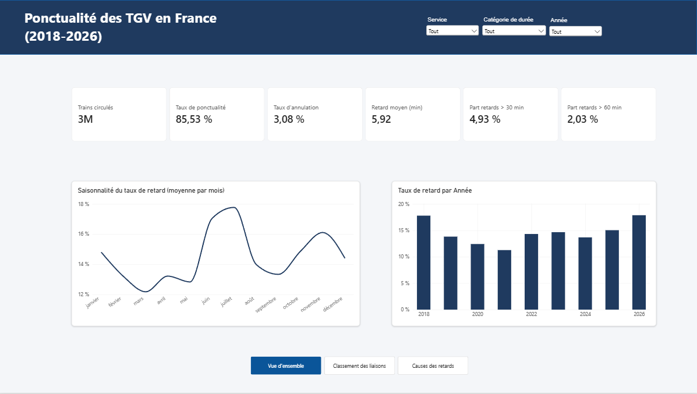
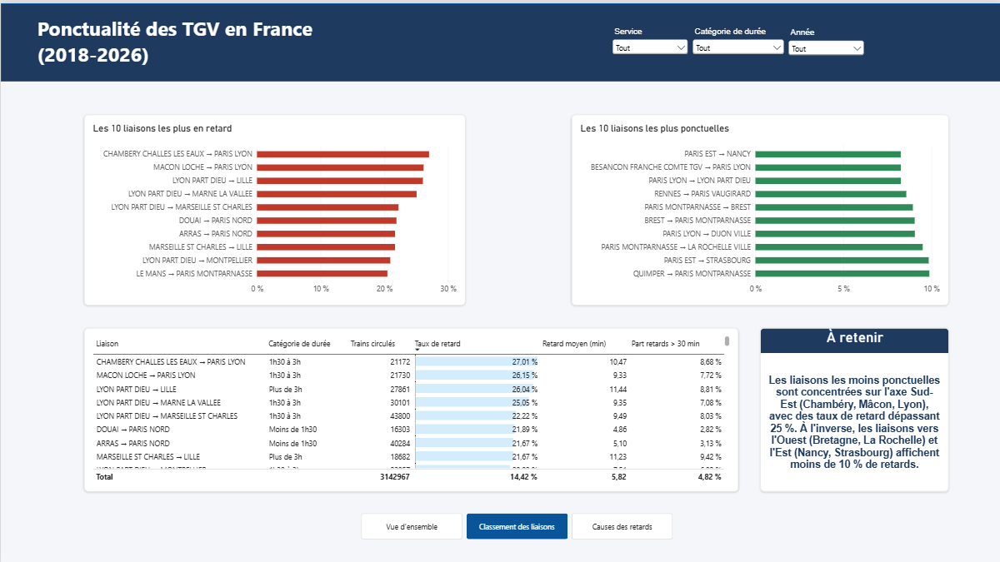
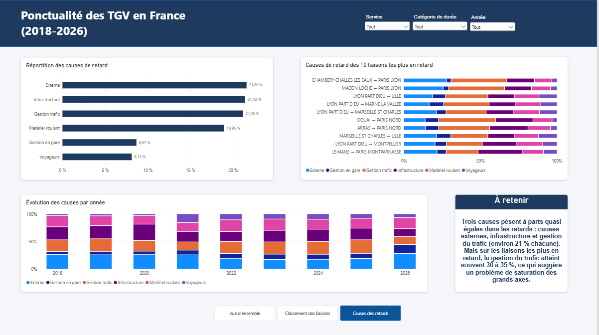
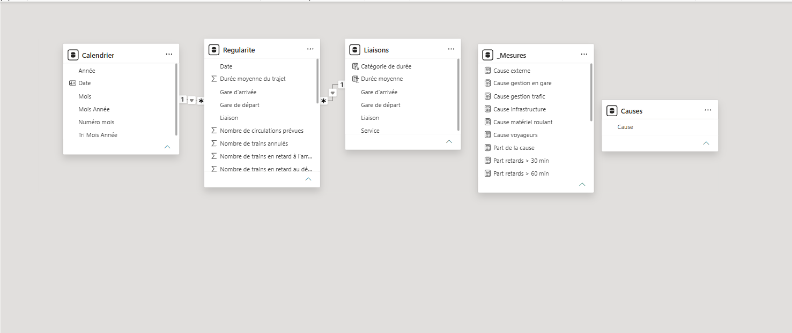

# Analyse de la ponctualité des TGV en France – Dashboard Power BI

Projet d'analyse de données explorant la régularité du réseau TGV français à partir des données ouvertes de la SNCF.

---

## Contexte

Ce projet répond à la question suivante : **quelles liaisons TGV sont les moins ponctuelles, et pourquoi ?**

L'objectif est de proposer un outil d'aide à la décision et de diagnostic interactif permettant d'analyser l'évolution de la ponctualité, d'identifier les liaisons critiques du réseau et d'examiner la typologie des causes de retards.

---

## Données utilisées

- **Source :** Open Data SNCF Voyageurs, jeu de données *« Régularité mensuelle TGV par liaisons »* disponible sur [data.gouv.fr](https://www.data.gouv.fr/) et [ressources.data.sncf.com](https://ressources.data.sncf.com/).
- **Période analysée :** Janvier 2018 à 2026 (année 2026 incomplète).
- **Volume :** Plus de 3 millions de TGV analysés.
- **Licence :** Open Database License (ODbL). Mention obligatoire de la source : *SNCF Voyageurs*.

---

## Démarche et Architecture

1. **Nettoyage et transformation des données (Power Query) :**
   - Typage strict des données et harmonisation des séparateurs décimaux.
   - Création d'une clé de liaison unique (colonne `Liaison` : Départ → Arrivée).
   - Nettoyage et suppression des colonnes de commentaires textuels non structurées.

2. **Modélisation dimensionnelle (Modèle en étoile) :**
   - **Table de faits :** `Regularite`
   - **Dimensions :** `Calendrier`, `Liaisons`, `Causes`

3. **Mesures DAX :**
   - *Taux de ponctualité*, *taux de retard*, *taux d'annulation*.
   - *Retard moyen pondéré* par le volume de trains ayant circulé.
   - *Part des retards supérieurs à 30 minutes et 60 minutes*.
   - *Répartition dynamique des causes de retard* (implémentation via une mesure DAX `SWITCH` s'appuyant sur une table de causes déconnectée).

---

## Aperçu du Tableau de Bord

### Page 1 : Vue d'ensemble
Vue globale sur les indicateurs clés de ponctualité, l'évolution temporelle et la saisonnalité des retards.

### Page 2 : Classement des liaisons
Palmarès et cartographie des liaisons les plus impactées par les retards sur le réseau.

### Page 3 : Causes des retards
Décomposition analytique des facteurs explicatifs des retards (externes, infrastructure, trafic, matériel).

### Modèle de données en étoile
Architecture relationnelle mise en œuvre dans Power BI.

---

## Résultats clés

- **85,5 %** des TGV sont arrivés à l'heure sur l'ensemble de la période étudiée, avec un retard moyen d'environ **6 minutes**.
- **Saisonnalité marquée :** un pic récurrent de retards est observé en **juin-juillet**, suivi d'un second pic au mois de **novembre**.
- **Disparités géographiques majeures :** les liaisons de l'**axe Sud-Est** figurent parmi les moins ponctuelles (jusqu'à **27 % de retards** pour la liaison *Chambéry → Paris Gare de Lyon*), à l'opposé des liaisons vers l'**Ouest** et l'**Est** qui affichent moins de **10 % de retards**.
- **Origine des retards :**
  - À l'échelle nationale, trois catégories de causes se partagent le volume de manière quasi équivalente (~**21 % chacune**) : *causes externes*, *infrastructure*, et *gestion du trafic*.
  - Sur les liaisons les plus touchées par les retards, la part attribuable à la **gestion du trafic** monte nettement pour atteindre **30 % à 35 %**.

---

## Recommandations

- Prioriser les actions et moyens de régulation sur la **gestion opérationnelle du trafic** au niveau des grands axes saturés, tout particulièrement sur l'**axe Sud-Est**.
- Renforcer les dispositifs préventifs et de gestion de flux lors de la **période estivale** (juin-juillet), période de forte tension sur le réseau.

---

## Limites de l'analyse

- Les données de l'année **2026** sont partielles et incomplètes à date.
- **Périmètre des calculs :** un même train pouvant figurer sur plusieurs liaisons, aucune ponctualité nationale consolidée n'est extrapolée directement de ce fichier.
- **Causalité vs Corrélation :** la saturation d'axe reste une hypothèse explicative forte ; les données observées démontrent une corrélation statistique et non une causalité formellement prouvée.
- Les liaisons internationales, comptabilisant un faible volume de circulations, ont été exclues des classements de régularité.

---

## Outils

- **Power BI Desktop**
- **Power Query (M)**
- **DAX**

---

## Comment consulter ou exécuter le projet

- Télécharger le fichier [`Ponctualite_TGV.pbix`](Ponctualite_TGV.pbix) et l'ouvrir avec [Power BI Desktop](https://powerbi.microsoft.com/desktop/) (gratuit sur Windows).
- Consulter le rapport complet au format PDF via [`Ponctualite_TGV.pdf`](Ponctualite_TGV.pdf).
- Les données sources brutes sont accessibles dans le dossier [`data/`](data/regularite-mensuelle-tgv-aqst.csv).

---

## Auteur

Projet réalisé par **Chatodit Lokonga Kongolo**  
- LinkedIn : [Chatodit Lokonga Kongolo](https://www.linkedin.com/in/chatodit-lokonga-kongolo/)
- GitHub : [@chatodit](https://github.com/chatodit)
